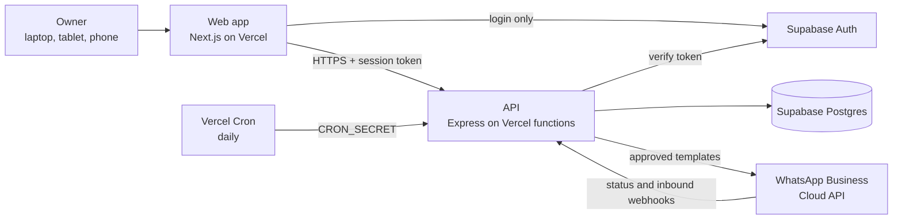
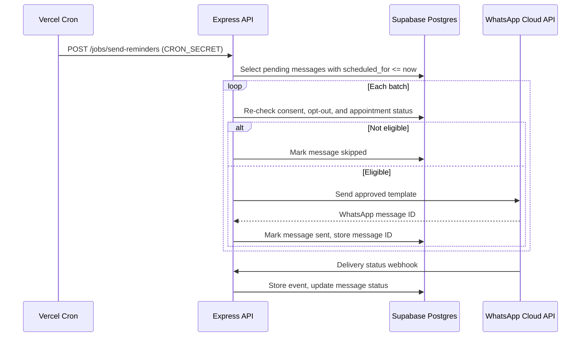

# Beauty Clinic CRM: Architecture

| | |
|---|---|
| **Status** | Proposed, for review |
| **Last updated** | 2026-10-29 |
| **Related** | [01-project-description.md](01-project-description.md), [02-plan.md](02-plan.md), [04-database.md](04-database.md) |

## 1. Context and goals

The system is a single-tenant web application for one clinic. Its core jobs are to keep bookings conflict-free, record client history and payments, and send WhatsApp messages automatically.

The architecture should be simple to run, inexpensive at this scale, and careful with personal client data. It should also leave room for staff roles and multiple branches without a rewrite.

## 2. Non-functional requirements

| Area | Requirement |
|---|---|
| Availability | Target 99.5% monthly during clinic hours. Platform SLAs set the ceiling. |
| Latency | Common screens load in under 1.5 seconds on a normal connection. API p95 under 500 ms, excluding cold starts. |
| Data integrity | No double-booked slots. No package session used twice. Money stored exactly. |
| Security | Login required for all data. No secrets in the browser. Personal data protected in transit and at rest. |
| Reliability | Each reminder is sent at most once. Webhooks are processed at least once without duplicate side effects. |
| Scale | One clinic, one owner, a few thousand clients, and a few hundred appointments a month. The design should handle ten times that without re-architecture. |
| Cost | Low monthly platform cost at launch. Document the paid upgrades needed as usage grows. |
| Operability | One developer can deploy, roll back, and restore backups. |

## 3. System overview



## 4. Components

| Component | Technology | Responsibility |
|---|---|---|
| Web app | Next.js, React, TypeScript, on Vercel | Calendar, clients, services, packages, payments, and dashboard screens. Handles login. Never accesses the database directly. |
| API | Node.js, Express, TypeScript, on Vercel serverless functions | Business rules, validation, authorization, transactions, reminder scheduling, and webhooks. |
| Database | Supabase Postgres (Cloud) | System of record. Constraints enforce integrity rules. |
| Auth | Supabase Auth, email and password | Owner accounts and session tokens. |
| Scheduler | Vercel Cron | Calls the reminder job endpoint once a day. |
| Messaging | WhatsApp Business Cloud API | Sends template messages and reports delivery status and inbound replies. |

The repository is a monorepo with two deployable apps, `apps/web` and `apps/api`. Each app is a separate Vercel project. Shared TypeScript types and validation schemas live in a `packages/shared` folder, so the web app and API agree on request shapes.

## 5. Key flows

### 5.1 Booking an appointment

1. The owner selects a client, a service, and a start time in the web app.
2. The web app calls `POST /api/v1/appointments` with an `Idempotency-Key` header.
3. The API validates the input, loads the service for its duration and price, calculates the end time, and inserts the appointment.
4. The database's exclusion constraint rejects an overlapping active appointment. The API turns that error into `409 Conflict`, with the conflicting time in the response.
5. On success, the API creates a pending `appointment_reminder` message for the day before, at the configured send time.
6. The calendar refreshes with the new appointment.

### 5.2 Completing a visit with a package

1. The owner marks the appointment complete.
2. The API calls the `complete_appointment` database function. The function locks the package row, checks the remaining sessions, records a usage row, and updates the appointment status, all in one transaction.
3. If no sessions remain, the function raises an error and the API returns `422 Unprocessable Entity`.
4. If the service has a follow-up interval, the API creates a pending `follow_up` message for the completion date plus that interval.
5. If the package now has one session left, the API creates a pending `package_renewal` message.

### 5.3 Daily reminder job



Reminders are created when the event happens, and the daily job only sends what is due. This means the send time is fixed at one daily run. A reminder due earlier in the day waits for the next run.

Eligibility is checked again at send time, because a client may opt out or an appointment may be cancelled after the reminder was created.

### 5.4 Delivery status webhook

1. Meta posts a status event to `POST /api/v1/webhooks/whatsapp`.
2. The API verifies the `X-Hub-Signature-256` header against the app secret and rejects unsigned requests.
3. The API stores the raw payload in `webhook_events`, then returns `200` quickly.
4. The API updates the matching message by `whatsapp_message_id`. Unknown IDs are logged and ignored.

Inbound messages use the same endpoint. A "STOP" reply marks the client as opted out.

### 5.5 Login

1. The web app calls Supabase Auth directly with the owner's email and password.
2. Supabase returns an access token.
3. The web app sends the token as a bearer token on each API call.
4. The API verifies the token with Supabase, then loads the owner's profile and role.

## 6. API design

- **Base path:** `/api/v1`. JSON only.
- **Time:** ISO 8601 with an offset in requests and responses. Stored as UTC.
- **Errors:** a consistent envelope, for example:

  ```json
  {
    "error": {
      "code": "APPOINTMENT_CONFLICT",
      "message": "This time overlaps another appointment.",
      "details": { "conflictsWith": "2026-11-02T10:00:00+02:00" }
    }
  }
  ```

- **Status codes:** `400` for validation, `401` when not logged in, `403` when not allowed, `404` when not found, `409` for conflicts, `422` for business-rule failures such as no sessions remaining, and `500` for unexpected errors.
- **Idempotency:** endpoints that create appointments, payments, or packages accept an `Idempotency-Key` header. The response is stored for 24 hours, so a retried request returns the same result instead of creating a duplicate.
- **Pagination:** cursor-based for client and message lists, with a default page size of 25.
- **Versioning:** the `/v1` prefix. Breaking changes go to `/v2`.

### Resource overview

| Method and path | Purpose |
|---|---|
| `GET`, `PUT /clinic-settings` | Read and update clinic settings |
| `GET`, `POST /services`, `PATCH /services/:id` | Service catalog |
| `GET`, `POST /clients`, `GET`, `PATCH /clients/:id` | Client profiles |
| `GET /clients/:id/history` | Visits, packages, payments, and messages for one client |
| `GET`, `POST /appointments`, `PATCH /appointments/:id` | Calendar |
| `POST /appointments/:id/complete` | Complete a visit and deduct a package session |
| `POST /appointments/:id/no-show` | Mark a no-show |
| `POST /appointments/:id/cancel` | Cancel and free the slot |
| `GET`, `POST /package-templates` | Package offers |
| `POST /client-packages` | Sell a package to a client |
| `GET`, `POST /payments` | Record and list payments |
| `POST /payments/:id/void` | Void a payment. There are no deletes |
| `GET`, `POST /exchange-rates` | Current rate and rate history |
| `GET /messages` | Message log |
| `GET /dashboard` | Summary for today |
| `GET`, `POST /webhooks/whatsapp` | Meta verification, status events, and inbound messages. Signature checked |
| `POST /jobs/send-reminders` | Daily job. Callable only with `CRON_SECRET` |
| `GET /health` | Health check |

## 7. Security

- **Authentication:** every route requires a valid Supabase token, except the WhatsApp webhook (which requires a valid signature) and the job endpoint (which requires `CRON_SECRET`).
- **Authorization:** for the MVP, the owner role can access all data. Each route checks the role, so adding staff roles later means changing one middleware.
- **Database access:** only the API uses the Supabase service role key, stored as an encrypted Vercel environment variable. The key never reaches the browser. Row-level security is enabled on every table with no policies for client roles, as a second layer of protection. See [04-database.md](04-database.md).
- **Secrets:** Supabase URL and service key, WhatsApp access token, webhook app secret, and `CRON_SECRET`, all stored as environment variables. Rotate them whenever access changes.
- **Input validation:** every endpoint validates its input against a schema. Queries go through the Supabase client, never through string concatenation.
- **Webhook security:** verify the Meta signature on every event. Reject anything unsigned.
- **Transport:** HTTPS only, enforced by Vercel.
- **Personal data:** phone numbers and treatment notes are sensitive. Keep them out of logs and error messages. Show only what each list needs.
- **Audit log:** creates, updates, voids, completions, and rate changes each write a row to `audit_logs`.
- **Backups:** Supabase's automated backups, with retention checked against the plan. The owner also receives a periodic export. A restore is tested before launch.

## 8. Reliability and failure handling

- **Transactions:** every multi-step write runs in a single transaction. This covers completing a visit, selling a package, and recording a payment tied to a package.
- **Database constraints as the final guard:** the overlap exclusion, the unique usage per appointment, and the one-message-per-reference rule hold even if application code has a bug.
- **Idempotency:** creating endpoints use idempotency keys. The unique constraint on `messages (kind, reference_id)` prevents duplicate reminders, even if the job runs twice.
- **Retries:** a failed send is retried on the next daily run, up to three attempts. After that, the message is marked `failed` and listed on the dashboard for follow-up.
- **Webhooks:** acknowledged immediately and processed idempotently.
- **Degraded mode:** if WhatsApp is unavailable, the rest of the app keeps working. Pending reminders stay pending and send on the next successful run.

## 9. Time and currency

- **Timestamps:** stored as `timestamptz` in UTC and displayed in `Asia/Beirut`.
- **Reminder timing:** Vercel Cron expressions are in UTC, but Beirut's offset changes with daylight saving. The job compares times in `Asia/Beirut`, so the owner's chosen send time stays correct across the change.
- **Money:** exact decimal values, with USD as the base currency. Each LBP payment stores the rate in effect when it was recorded, and the USD equivalent is calculated and stored with it.
- **Exchange rates:** a rate change is a new row, never an update. The current rate is the latest row whose effective date has passed.

## 10. Observability

- **Logs:** structured JSON from the API, with a request ID, route, status code, duration, and user ID. No personal data.
- **Errors:** an error tracking service for both the web app and the API.
- **Health check:** `GET /health`.
- **Alerts:** reminder job failures, webhook signature failures, and spikes in the error rate.
- **Delivery metrics:** sent, delivered, read, and failed counts, computed from the `messages` table.

## 11. Environments and deployment

| Environment | Purpose | Data |
|---|---|---|
| Local | Development | Local Supabase (`supabase start`) and seed data |
| Staging | Testing before release, and WhatsApp tests with approved numbers | Test data only |
| Production | Clinic use | Real client data |

- Database changes are written as migrations under version control and applied to staging first.
- A push to the main branch deploys to production. Pull requests get Vercel preview deployments.
- **Rollback:** redeploy the previous Vercel deployment. For the database, write a new forward migration. Never edit a migration that has already been applied.
- Configuration comes from environment variables, set separately for each environment.

## 12. Scalability and revisit triggers

The design is well beyond current needs. Revisit it if any of these happen:

| Trigger | Response |
|---|---|
| Reminder runs exceed the serverless time limit | Split the job into smaller runs, or move it to a worker |
| Reminders need precision finer than one daily run | Move scheduling to a dedicated worker or a database scheduler |
| A second clinic needs the system | Add `clinic_id` to every table and enforce it with row-level security |
| Staff need separate calendars | Add `staff_id` and a per-staff overlap constraint |
| Offline use becomes necessary | Add a local-first data layer with sync |
| Message volume grows | Review WhatsApp pricing and batch sends where possible |

## 13. Architecture decisions

Each decision is recorded in condensed ADR form.

### ADR-001: Separate Express API

- **Decision:** business logic lives in a separate Node/Express API, not in Next.js API routes or in browser-side Supabase calls.
- **Alternatives:** Next.js-only API routes; direct browser access to Supabase with row-level security.
- **Consequences:** a clear home for transactions, webhooks, and scheduled jobs, and reusable by a future mobile app. It means two apps to deploy, which the monorepo keeps manageable.

### ADR-002: Express on Vercel serverless functions

- **Decision:** host the API as Vercel serverless functions, and schedule jobs with Vercel Cron.
- **Alternatives:** Railway or Render (always-on container); a DigitalOcean droplet running PM2 and Nginx.
- **Consequences:** no servers to maintain, and the same platform as the frontend. Cold starts and function time limits apply. Cron frequency depends on the plan. No state can be kept in memory between requests. Revisit this if the limits become a problem (section 12).

### ADR-003: Supabase Auth with email and password

- **Decision:** the owner logs in with email and password.
- **Alternatives:** magic link by email; phone code (OTP).
- **Consequences:** simple and free. Phone codes cost money per SMS, but may suit staff logins later. A magic link can be added later without changing the data model.

### ADR-004: WhatsApp Business Cloud API, fully automated

- **Decision:** the API sends approved template messages, and delivery status comes back by webhook.
- **Alternatives:** click-to-chat links that open WhatsApp for manual sending. Kept as a fallback if approval is delayed.
- **Consequences:** requires Meta verification and template approval, which means a waiting period before launch. Messages are billed per conversation, so check current pricing. Client consent must be recorded and respected.

### ADR-005: Exact decimal money with rate snapshots

- **Decision:** money is stored as `numeric`. USD is the base. Each LBP payment stores the exchange rate used.
- **Alternatives:** floating-point numbers; storing LBP only.
- **Consequences:** past reports stay accurate after rate changes. Payment entry is slightly more involved.

### ADR-006: The database is reached only through the API

- **Decision:** the browser never talks to Postgres. Row-level security is enabled on every table with no client policies.
- **Alternatives:** direct browser access, with per-row security policies.
- **Consequences:** all authorization logic is in one place. Browser-side real-time subscriptions are not used in the MVP.

### ADR-007: One calendar with a database overlap constraint

- **Decision:** all appointments share one calendar in the MVP. Overlaps are prevented by an exclusion constraint on the time range.
- **Alternatives:** separate calendars for each staff member from the start.
- **Consequences:** simple and correct for one owner. Adding staff later requires a `staff_id` column and an updated constraint. This is a planned migration.

## 14. Open technical questions

- Confirm which Vercel and Supabase plans are needed for the cron frequency, function time limits, and backup retention.
- Choose an error tracking service.
- Choose a transactional email provider for password resets. Supabase's built-in email is rate-limited, so a custom SMTP provider should be set up before launch.
- Confirm the monorepo layout (recommended) or separate repositories.
