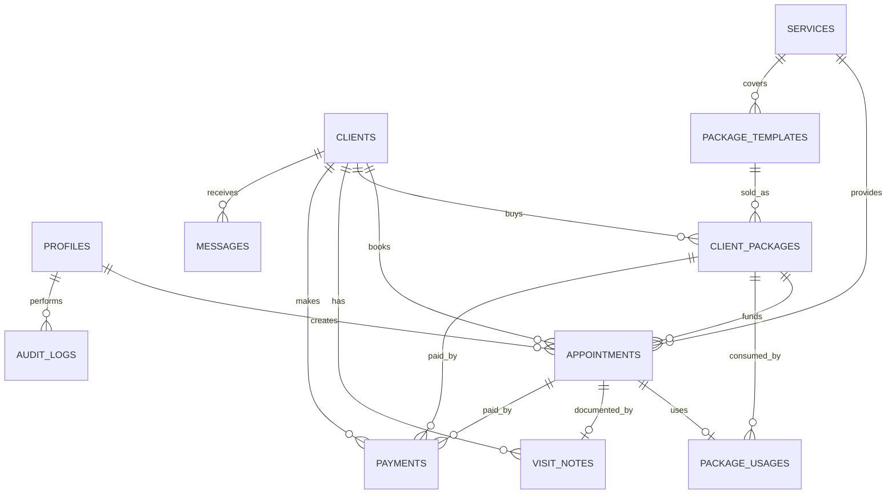

# Beauty Clinic CRM: Database

| | |
|---|---|
| **Status** | Proposed, for review |
| **Engine** | PostgreSQL on Supabase Cloud |
| **Last updated** | 2026-10-29 |
| **Related** | [01-project-description.md](01-project-description.md), [02-plan.md](02-plan.md), [03-architecture.md](03-architecture.md) |

## 1. Conventions

- **Primary keys:** `uuid` generated with `gen_random_uuid()`. The exception is `audit_logs`, which uses a `bigint` identity.
- **Timestamps:** `timestamptz`, stored in UTC. Every table has `created_at`. Tables whose rows change also have `updated_at`.
- **Money:** `numeric` with explicit precision. USD is the base currency.
- **Naming:** `snake_case`, with plural table names.
- **Enumerations:** `text` columns with `check` constraints. Changing a value list is a small migration.
- **Phone numbers:** E.164 format, for example `+96170123456`.
- **Deletion:** clients are soft-deleted with `deleted_at`. Appointments are cancelled, and payments are voided. Financial and visit records are never hard-deleted.

## 2. Entity overview



`messages.reference_id` points at an appointment or a client package, depending on the message kind. Because it can point at either, it has no foreign key. The unique constraint on `(kind, reference_id)` still prevents duplicates.

## 3. Table reference

| Table | Purpose | Growth |
|---|---|---|
| `profiles` | The owner, and later staff, linked to Supabase Auth | Very slow |
| `clinic_settings` | One row of clinic configuration | Fixed |
| `exchange_rates` | LBP-per-USD rates with effective dates | A few rows a month |
| `clients` | Client profiles and WhatsApp consent | One row per new client |
| `services` | Service catalog | Slow |
| `package_templates` | Package offers | Slow |
| `client_packages` | Packages sold to clients, with copied terms | One row per sale |
| `appointments` | Calendar entries | Several a day |
| `package_usages` | One row for each package session used | One row per completed package visit |
| `visit_notes` | Treatment notes for each visit | One row per visit |
| `payments` | Money received | One row per payment |
| `messages` | Scheduled and sent WhatsApp messages | One row per reminder |
| `webhook_events` | Raw WhatsApp webhook payloads | One row per status update |
| `idempotency_keys` | Stored responses for retried requests | Cleared after 24 hours |
| `audit_logs` | Record of changes | One row per change |

## 4. Schema definition (DDL)

The statements are in dependency order, so each one can run as written.

### 4.1 Staff and settings

```sql
-- Owner and future staff, linked to Supabase Auth
create table profiles (
  id          uuid primary key references auth.users(id) on delete cascade,
  full_name   text not null,
  role        text not null default 'owner'
              check (role in ('owner', 'manager', 'staff')),
  created_at  timestamptz not null default now()
);

-- Single-row clinic configuration
create table clinic_settings (
  id                 int primary key default 1 check (id = 1),
  name               text not null,
  phone_e164         text check (phone_e164 ~ '^\+[1-9][0-9]{7,14}$'),
  address            text,
  timezone           text not null default 'Asia/Beirut',
  base_currency      text not null default 'USD' check (base_currency = 'USD'),
  reminder_send_time time not null default '10:00',
  updated_at         timestamptz not null default now()
);

-- LBP-per-USD rates. A change is a new row, never an update.
create table exchange_rates (
  id              uuid primary key default gen_random_uuid(),
  lbp_per_usd     numeric(12,2) not null check (lbp_per_usd > 0),
  effective_from  timestamptz not null default now(),
  set_by          uuid references profiles(id),
  created_at      timestamptz not null default now()
);
```

### 4.2 Clients and catalog

```sql
create table clients (
  id                    uuid primary key default gen_random_uuid(),
  full_name             text not null,
  phone_e164            text not null check (phone_e164 ~ '^\+[1-9][0-9]{7,14}$'),
  instagram_handle      text,
  email                 text,
  source                text check (source in ('instagram', 'whatsapp', 'phone', 'walk_in', 'referral', 'other')),
  whatsapp_consent_at   timestamptz,      -- null means no consent recorded
  whatsapp_opt_out_at   timestamptz,      -- set when the client replies STOP
  notes                 text,
  created_at            timestamptz not null default now(),
  updated_at            timestamptz not null default now(),
  deleted_at            timestamptz
);

-- Phone numbers are unique among active clients only
create unique index clients_phone_active_idx
  on clients (phone_e164) where deleted_at is null;

create table services (
  id                        uuid primary key default gen_random_uuid(),
  name                      text not null,
  category                  text not null
                            check (category in ('skin_care', 'laser_injectables', 'hair_nails', 'waxing_body')),
  duration_minutes          int not null check (duration_minutes between 5 and 480),
  price_usd                 numeric(10,2) not null check (price_usd >= 0),
  follow_up_interval_days   int check (follow_up_interval_days > 0),
  is_active                 boolean not null default true,
  created_at                timestamptz not null default now(),
  updated_at                timestamptz not null default now()
);

create table package_templates (
  id              uuid primary key default gen_random_uuid(),
  name            text not null,
  service_id      uuid not null references services(id),
  session_count   int not null check (session_count > 1),
  price_usd       numeric(10,2) not null check (price_usd >= 0),
  validity_days   int not null default 180 check (validity_days > 0),
  is_active       boolean not null default true,
  created_at      timestamptz not null default now()
);
```

### 4.3 Packages and appointments

```sql
-- Packages sold to clients. Terms are copied at sale time, so later template changes don't affect them.
create table client_packages (
  id              uuid primary key default gen_random_uuid(),
  client_id       uuid not null references clients(id),
  template_id     uuid not null references package_templates(id),
  service_id      uuid not null references services(id),
  sessions_total  int not null check (sessions_total > 0),
  price_usd       numeric(10,2) not null check (price_usd >= 0),
  purchased_at    timestamptz not null default now(),
  expires_at      timestamptz not null,
  status          text not null default 'active'
                  check (status in ('active', 'completed', 'expired', 'cancelled')),
  created_at      timestamptz not null default now()
);

create table appointments (
  id                 uuid primary key default gen_random_uuid(),
  client_id          uuid not null references clients(id),
  service_id         uuid not null references services(id),
  client_package_id  uuid references client_packages(id),
  start_at           timestamptz not null,
  end_at             timestamptz not null,
  status             text not null default 'scheduled'
                     check (status in ('scheduled', 'confirmed', 'completed', 'no_show', 'cancelled')),
  price_usd          numeric(10,2) not null check (price_usd >= 0),
  notes              text,
  created_by         uuid references profiles(id),
  created_at         timestamptz not null default now(),
  updated_at         timestamptz not null default now(),
  check (end_at > start_at),
  -- No two active appointments may overlap. Cancelled and no-show rows are excluded.
  exclude using gist (tstzrange(start_at, end_at, '[)') with &&)
    where (status in ('scheduled', 'confirmed', 'completed'))
);

-- One row per package session consumed. Each appointment consumes at most one session.
create table package_usages (
  id                 uuid primary key default gen_random_uuid(),
  client_package_id  uuid not null references client_packages(id),
  appointment_id     uuid not null unique references appointments(id),
  used_at            timestamptz not null default now()
);

create table visit_notes (
  id              uuid primary key default gen_random_uuid(),
  client_id       uuid not null references clients(id),
  appointment_id  uuid references appointments(id),
  body            text not null,
  products_used   text,
  created_by      uuid references profiles(id),
  created_at      timestamptz not null default now(),
  updated_at      timestamptz not null default now()
);
```

### 4.4 Payments

```sql
create table payments (
  id                         uuid primary key default gen_random_uuid(),
  client_id                  uuid not null references clients(id),
  appointment_id             uuid references appointments(id),
  client_package_id          uuid references client_packages(id),
  currency                   text not null check (currency in ('USD', 'LBP')),
  amount                     numeric(16,2) not null check (amount > 0),
  exchange_rate_lbp_per_usd  numeric(12,2),
  amount_usd                 numeric(12,2) not null check (amount_usd >= 0),
  method                     text not null default 'cash' check (method in ('cash', 'card', 'wallet')),
  paid_at                    timestamptz not null default now(),
  recorded_by                uuid references profiles(id),
  voided_at                  timestamptz,
  void_reason                text,
  created_at                 timestamptz not null default now(),
  -- An LBP payment must record the rate used
  check (currency = 'USD' or exchange_rate_lbp_per_usd is not null),
  -- A payment is for exactly one appointment or one package sale
  check (num_nonnulls(appointment_id, client_package_id) = 1)
);
```

### 4.5 Messages, webhooks, and system tables

```sql
-- Every scheduled or sent WhatsApp message. The unique key prevents duplicate reminders.
create table messages (
  id                    uuid primary key default gen_random_uuid(),
  client_id             uuid not null references clients(id),
  kind                  text not null
                        check (kind in ('appointment_reminder', 'follow_up', 'package_renewal')),
  reference_id          uuid not null,          -- appointment or client package, depending on kind
  template_name         text not null,
  scheduled_for         timestamptz not null,
  status                text not null default 'pending'
                        check (status in ('pending', 'sent', 'delivered', 'read', 'failed', 'skipped')),
  whatsapp_message_id   text unique,
  attempts              int not null default 0,
  last_error            text,
  sent_at               timestamptz,
  created_at            timestamptz not null default now(),
  unique (kind, reference_id)
);

-- Raw webhook payloads, kept so events can be reprocessed
create table webhook_events (
  id            uuid primary key default gen_random_uuid(),
  provider      text not null default 'whatsapp',
  payload       jsonb not null,
  received_at   timestamptz not null default now(),
  processed_at  timestamptz
);

-- Stored responses so a retried POST returns the original result
create table idempotency_keys (
  key          text not null,
  route        text not null,
  response     jsonb not null,
  status_code  int not null,
  created_at   timestamptz not null default now(),
  primary key (key, route)
);

create table audit_logs (
  id           bigint generated always as identity primary key,
  actor_id     uuid references profiles(id),
  action       text not null,                   -- for example 'appointment.complete'
  entity       text not null,                   -- for example 'appointments'
  entity_id    uuid,
  before_data  jsonb,
  after_data   jsonb,
  created_at   timestamptz not null default now()
);
```

## 5. Integrity rules

| Rule | Enforced by |
|---|---|
| No overlapping active appointments | Exclusion constraint on `appointments` |
| An appointment consumes at most one package session | Unique `appointment_id` on `package_usages` |
| A package can't go above its session count | `complete_appointment` under a row lock |
| One reminder per kind per reference | Unique `(kind, reference_id)` on `messages` |
| Unique phone number among active clients | Partial unique index on `clients` |
| LBP payments record the exchange rate | Check constraint on `payments` |
| A payment is for one appointment or one package | Check constraint on `payments` |
| End time after start time | Check constraint on `appointments` |
| Exchange rates are never edited | Application rule. Changes are inserts |
| Clinical and financial records are never deleted | Application rule. Use void or cancel |

## 6. Functions

### 6.1 `complete_appointment`

Completes a visit. If the visit uses a package, it also records one session as used. The package row is locked, so two completions can't use the last session at the same time.

```sql
create or replace function complete_appointment(p_appointment_id uuid)
returns void
language plpgsql
as $$
declare
  appt       record;
  remaining  int;
begin
  select id, status, client_package_id
    into appt
    from appointments
   where id = p_appointment_id
   for update;

  if not found then
    raise exception 'APPOINTMENT_NOT_FOUND';
  end if;

  if appt.status not in ('scheduled', 'confirmed') then
    raise exception 'INVALID_STATUS_TRANSITION: %', appt.status;
  end if;

  if appt.client_package_id is not null then
    -- Lock the package so two visits can't consume the last session together
    perform 1 from client_packages where id = appt.client_package_id for update;

    -- Remaining sessions, for an active and unexpired package only
    select cp.sessions_total - count(pu.id)
      into remaining
      from client_packages cp
      left join package_usages pu on pu.client_package_id = cp.id
     where cp.id = appt.client_package_id
       and cp.status = 'active'
       and cp.expires_at > now()
     group by cp.sessions_total;

    if remaining is null or remaining <= 0 then
      raise exception 'NO_SESSIONS_REMAINING';
    end if;

    insert into package_usages (client_package_id, appointment_id)
    values (appt.client_package_id, p_appointment_id);
  end if;

  update appointments
     set status = 'completed', updated_at = now()
   where id = p_appointment_id;
end;
$$;
```

The API maps `NO_SESSIONS_REMAINING` to `422` and `APPOINTMENT_NOT_FOUND` to `404`. An overlap error from the exclusion constraint has SQLSTATE `23P01`, which the API maps to `409`.

## 7. Views

```sql
-- Sessions remaining on each package
create view client_package_balances
with (security_invoker = true) as
select
  cp.id              as client_package_id,
  cp.client_id,
  cp.sessions_total,
  cp.sessions_total - count(pu.id) as sessions_remaining,
  cp.status,
  cp.expires_at
from client_packages cp
left join package_usages pu on pu.client_package_id = cp.id
group by cp.id;
```

## 8. Indexes

```sql
create extension if not exists pg_trgm;

create index appointments_start_idx        on appointments (start_at);
create index appointments_client_idx       on appointments (client_id, start_at desc);
create index client_packages_client_idx    on client_packages (client_id, status);
create index payments_client_idx           on payments (client_id, paid_at desc);
create index exchange_rates_effective_idx  on exchange_rates (effective_from desc);
create index clients_name_search_idx       on clients using gin (full_name gin_trgm_ops);

-- The daily job scans only pending messages that are due
create index messages_due_idx on messages (scheduled_for) where status = 'pending';
```

## 9. Row-level security

Every table has row-level security enabled, with no policies for the `anon` or `authenticated` roles. Only the service role, which the API uses, can read or write.

```sql
alter table profiles            enable row level security;
alter table clinic_settings     enable row level security;
alter table exchange_rates      enable row level security;
alter table clients             enable row level security;
alter table services            enable row level security;
alter table package_templates   enable row level security;
alter table client_packages     enable row level security;
alter table appointments        enable row level security;
alter table package_usages      enable row level security;
alter table visit_notes         enable row level security;
alter table payments            enable row level security;
alter table messages            enable row level security;
alter table webhook_events      enable row level security;
alter table idempotency_keys    enable row level security;
alter table audit_logs          enable row level security;
```

The service role bypasses row-level security, so the API must check authorization in its own middleware. Row-level security is the backstop if the browser ever gets a key it shouldn't have.

## 10. Seed data

Run seed data separately from migrations, and only in local and staging environments.

- **`clinic_settings`:** one row with the clinic name, phone, and timezone `Asia/Beirut`.
- **`services`:** one entry per category to start with. Names, durations, and prices come from the owner. Do not seed invented prices.
- **`exchange_rates`:** the starting rate comes from the owner. Insert it as the first row.
- **`profiles`:** created when the owner first signs up through Supabase Auth.

## 11. Example queries

**Today's appointments, in Beirut time:**

```sql
select a.id, a.start_at, a.end_at, a.status, c.full_name, s.name as service
  from appointments a
  join clients c on c.id = a.client_id
  join services s on s.id = a.service_id
 where a.start_at >= date_trunc('day', now() at time zone 'Asia/Beirut') at time zone 'Asia/Beirut'
   and a.start_at <  (date_trunc('day', now() at time zone 'Asia/Beirut') + interval '1 day') at time zone 'Asia/Beirut'
   and a.status in ('scheduled', 'confirmed')
 order by a.start_at;
```

**Reminders due now:**

```sql
select id, client_id, kind, reference_id, template_name
  from messages
 where status = 'pending'
   and scheduled_for <= now()
 order by scheduled_for
 limit 50;
```

**Client history:**

```sql
select 'visit' as kind, a.start_at as at, s.name as detail
  from appointments a join services s on s.id = a.service_id
 where a.client_id = $1 and a.status = 'completed'
union all
select 'payment', p.paid_at, p.currency || ' ' || p.amount::text
  from payments p
 where p.client_id = $1 and p.voided_at is null
order by at desc;
```

## 12. Migrations and change process

- Migrations live in `supabase/migrations` with timestamped file names. Never edit a migration that has already been applied.
- Every change goes through local, then staging, then production.
- Seed data is kept separate from migrations.
- Backups: use point-in-time recovery if the plan includes it. Otherwise rely on daily backups plus the owner's periodic export.

## 13. Retention and deletion

| Data | Proposed rule | Status |
|---|---|---|
| Client profile | Soft-deleted on request. Personal fields are cleared, and the record is kept for financial history | Confirm with owner |
| Visit notes | Kept for the life of the client record | Open question |
| Payments | Kept. Voided, never deleted | Agreed in principle |
| Messages | Kept for 12 months, then the body is removed | Proposed |
| Webhook events | Kept for 90 days | Proposed |
| Idempotency keys | Removed after 24 hours | Proposed |
| Audit logs | Kept indefinitely | Proposed |

On a deletion request, the client's name and phone are cleared, and `deleted_at` is set. Payments and appointments keep their amounts and dates, so the books stay correct. Check any legal obligations for personal and health-related data before launch.

## 14. Open database questions

1. Should one appointment cover more than one service, for combined treatments? The current design allows one service per appointment.
2. Should packages ever cover more than one service? The current design ties a package to one service.
3. Should a no-show use up a package session? The current function does not consume a session for no-shows.
4. What are the retention periods for visit notes, messages, and webhook events?
