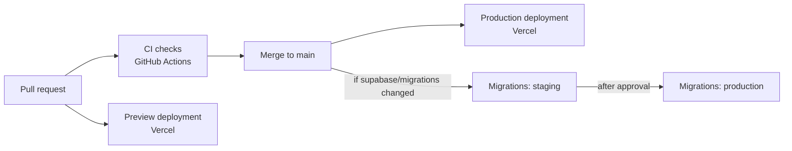

# Beauty Clinic CRM: CI/CD

| | |
|---|---|
| **Status** | Set up, needs one-time configuration (section 4) |
| **Last updated** | 2026-11-14 |
| **Related** | [03-architecture.md](03-architecture.md) section 11, [04-database.md](04-database.md) section 12 |

## 1. How a change reaches production



| Stage | Tool | Runs when |
|---|---|---|
| Checks | GitHub Actions, `ci.yml` | Every pull request and every push to `main` |
| Preview deploy | Vercel Git integration | Every pull request, for each app |
| Production deploy | Vercel Git integration | Push to `main` |
| Database migrations | GitHub Actions, `migrations.yml` | Push to `main` that changes `supabase/migrations/**`, or run by hand |

Deploys are done by Vercel, not by GitHub Actions. That keeps secrets out of the repository and gives previews for free. GitHub Actions adds the checks and the database step.

## 2. What the checks do

`ci.yml` has two jobs, and both must pass:

1. **Typecheck, lint, test, build.** The same four steps as `npm run ci`, so you can run exactly what the pipeline runs before you push. The build uses placeholder values for the three `NEXT_PUBLIC_*` variables. Nothing in CI talks to a real Supabase project.
2. **Dependency audit.** `npm audit --omit=dev --audit-level=high`. It looks only at packages that ship to users. A high-severity advisory fails the run, which is the point: fix it, or add an `overrides` entry as was done for `path-to-regexp`.

Runs for the same branch cancel each other, so only the newest push is checked.

## 3. Database migrations

- Files in `supabase/migrations` are the source of truth. An applied migration is never edited. A fix is a new file.
- A merge that changes them runs **staging** automatically, then **production** after a person approves it in GitHub. Each job first prints what it would run (`supabase db push --dry-run`), then applies it.
- Production only runs when the repository variable `PRODUCTION_ENABLED` is `true`. Until a production project exists, the pipeline stops after staging.
- Only one migration run happens at a time, and a run is never cancelled halfway.
- Migrations must work on a database that already holds real data. Add columns with defaults, backfill in a separate migration, and never drop something the running app still reads. The deployed app and the new schema are briefly out of step, so make each step safe on its own.

## 4. One-time setup

**GitHub**

1. Create the repository and push the project to it. The folder is not a git repository yet.
2. Settings > Environments: create `staging` and `production`. On `production`, turn on **Required reviewers** and add yourself.
3. In each environment add the secrets `SUPABASE_ACCESS_TOKEN` (a personal access token from the Supabase dashboard) and `SUPABASE_DB_PASSWORD`, and the variable `SUPABASE_PROJECT_REF` for that environment's project.
4. When a production project exists, add the repository variable `PRODUCTION_ENABLED` = `true`.
5. Settings > Branches: protect `main`. Require the **Typecheck, lint, test, build** and **Dependency audit** checks to pass, and require a pull request before merging.

**Vercel** (two projects, same repository)

| Setting | `web` project | `api` project |
|---|---|---|
| Root Directory | `apps/web` | `apps/api` |
| Framework | Next.js | Other |
| Include files outside the root directory | On (needed for `packages/shared`) | On |
| Environment variables | `NEXT_PUBLIC_SUPABASE_URL`, `NEXT_PUBLIC_SUPABASE_ANON_KEY`, `NEXT_PUBLIC_API_URL` | `SUPABASE_URL`, `SUPABASE_SECRET_KEY`, `SUPABASE_PUBLISHABLE_KEY`, `CRON_SECRET`, `WEB_ORIGIN`, WhatsApp variables later |

Set the variables separately for Preview and Production. Never put the Supabase secret key in the `web` project or in any `NEXT_PUBLIC_*` variable.

**Supabase**: allow the deployed web address under Authentication > URL Configuration, so password-reset and invite links can return to it. Switch off public sign-ups.

## 5. Rolling back

- **App:** in Vercel, promote the previous deployment. This takes seconds and needs no code change.
- **Database:** write a new forward migration that undoes the change. Do not edit or delete one that has been applied.

## 6. Local checks before pushing

```
npm run ci
```

Runs typecheck, lint, tests and build, the same as the pipeline.

## 7. Not covered yet

- **Browser tests.** The plan calls for Playwright on the critical flows (login, book, complete a visit, sell a package, record a payment). They need a test database and are added with Phase 2.
- **Error tracking and alerts.** Still an open question in the architecture document.
- **Scheduled cleanup.** Old idempotency keys and rate-limit rows are not yet removed on a schedule. This belongs with the daily cron job in Phase 3.
