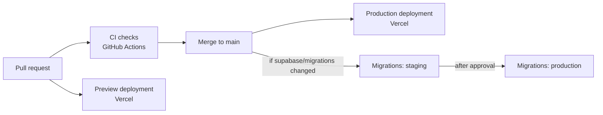

# Beauty Clinic CRM: CI/CD

| | |
|---|---|
| **Status** | Set up, needs one-time configuration (section 4) |
| **Last updated** | 2026-11-14 |
| **Related** | [03-architecture.md](03-architecture.md) section 11, [04-database.md](04-database.md) section 12 |

## 1. How a change reaches production



| Stage | Tool | Runs when |
|---|---|---|
| Checks | GitHub Actions, `ci.yml` | Every pull request and every push to `main` |
| Preview deploy | Vercel Git integration | Every pull request, for each app |
| Production deploy | Vercel Git integration | Push to `main` |
| Database migrations | GitHub Actions, `migrations.yml` | Push to `main` that changes `supabase/migrations/**`, or run by hand |

Deploys are done by Vercel, not by GitHub Actions. That keeps secrets out of the repository and gives previews for free. GitHub Actions adds the checks and the database step.

## 2. What the checks do

`ci.yml` has two jobs, and both must pass:

1. **Typecheck, lint, test, build.** The same four steps as `npm run ci`, so you can run exactly what the pipeline runs before you push. The build uses placeholder values for the three `NEXT_PUBLIC_*` variables. Nothing in CI talks to a real Supabase project.
2. **Dependency audit.** `npm audit --omit=dev --audit-level=high`. It looks only at packages that ship to users. A high-severity advisory fails the run, which is the point: fix it, or add an `overrides` entry as was done for `path-to-regexp`.

Runs for the same branch cancel each other, so only the newest push is checked.

## 3. Database migrations

- Files in `supabase/migrations` are the source of truth. An applied migration is never edited. A fix is a new file.
- A merge that changes them runs **staging** automatically, then **production** after a person approves it in GitHub. Each job first prints what it would run (`supabase db push --dry-run`), then applies it.
- Production only runs when the repository variable `PRODUCTION_ENABLED` is `true`. Until a production project exists, the pipeline stops after staging.
- Only one migration run happens at a time, and a run is never cancelled halfway.
- Migrations must work on a database that already holds real data. Add columns with defaults, backfill in a separate migration, and never drop something the running app still reads. The deployed app and the new schema are briefly out of step, so make each step safe on its own.

## 4. One-time setup

**GitHub**

1. The project lives at `github.com/hady-17/DeeClinic`. Push `main` there.
2. Settings > Environments: create `staging` and `production`. On `production`, turn on **Required reviewers** and add yourself.
3. In each environment add the secrets `SUPABASE_ACCESS_TOKEN` (a personal access token from the Supabase dashboard) and `SUPABASE_DB_PASSWORD`, and the variable `SUPABASE_PROJECT_REF` for that environment's project.
4. When a production project exists, add the repository variable `PRODUCTION_ENABLED` = `true`.
5. Settings > Branches: protect `main`. Require the **Typecheck, lint, test, build** and **Dependency audit** checks to pass, and require a pull request before merging.

## 4a. Deploying to Vercel for the first time

There are two Vercel projects from the one repository: the API and the web app. **Create the API first**, because the web app needs its address.

### How the API is built

The API is an Express app. `npm run build:vercel` (run by Vercel through `apps/api/vercel.json`) bundles it, together with the shared code, into one JavaScript file and writes it in Vercel's Build Output format under `apps/api/.vercel/output`. Building it ourselves means the result does not depend on how Vercel treats the workspace's TypeScript packages, and it is the same file locally, in CI and on Vercel. CI builds it and checks that it starts and answers on every pull request (`npm run smoke:vercel -w @deeclinic/api`).

### Step 1: the API project

1. Vercel dashboard > **Add New > Project**, and import `hady-17/DeeClinic`.
2. **Root Directory:** `apps/api`. Tick **Include source files outside of the Root Directory** (needed for `packages/shared`).
3. **Framework Preset:** Other. Leave the build and output settings alone. `vercel.json` sets the build command.
4. **Environment variables** (see the table below), then **Deploy**.
5. Open `https://<api-project>.vercel.app/api/v1/health`. It should answer `{"status":"ok", ...}`.

| Variable | Value |
|---|---|
| `SUPABASE_URL` | The project URL |
| `SUPABASE_SECRET_KEY` | The secret key. **Server only** |
| `SUPABASE_PUBLISHABLE_KEY` | The publishable key |
| `CRON_SECRET` | A random string of 16 or more characters |
| `PASSCODE_PEPPER` | A random string of 32 or more characters (`openssl rand -hex 32`). A different one per environment, kept in the password manager. Changing it invalidates every passcode |
| `WEB_ORIGIN` | The web address, once you have it (step 2). Several can be listed, separated by commas. A `*` matches part of a name, so `https://deeclinic-*.vercel.app` covers preview deployments |

### Step 2: the web project

1. **Add New > Project**, import the same repository again.
2. **Root Directory:** `apps/web`. Tick **Include source files outside of the Root Directory**. Framework Preset: Next.js (detected).
3. **Environment variables:**

| Variable | Value |
|---|---|
| `NEXT_PUBLIC_SUPABASE_URL` | The project URL |
| `NEXT_PUBLIC_SUPABASE_ANON_KEY` | The publishable key |
| `NEXT_PUBLIC_API_URL` | The API address from step 1, with no trailing slash: `https://<api-project>.vercel.app` |

4. **Deploy.** The variables are read when the app is built, so after changing one, redeploy.

### Step 3: join them up

1. In the **API** project, set `WEB_ORIGIN` to the web address (`https://<web-project>.vercel.app`, plus the preview pattern if you want previews to work) and **redeploy** it.
2. In **Supabase > Authentication > URL Configuration**, set the **Site URL** to the web address and add `https://<web-project>.vercel.app/reset-password` to the redirect URLs.
3. Switch off public sign-ups, and set up custom SMTP, as in the README.
4. Make sure the database has all migrations (section 3) and that the first owner exists (README, "The first owner").

### Step 4: check it

1. Open the web address and sign in.
2. Set your passcode under *My passcode*.
3. Book an appointment, then open it. If anything shows "Could not load", open the browser's network tab: a red request to the API address with a CORS error means `WEB_ORIGIN` does not match the web address exactly (including `https://`).

### Variables for any environment

Set variables separately for Production and Preview. Never put the Supabase secret key in the `web` project or in any `NEXT_PUBLIC_*` variable. Everything beginning with `NEXT_PUBLIC_` is visible to anyone who opens the site.

### Deploying from the command line instead

```
npx vercel login
cd apps/api && npx vercel link && npx vercel --prod
cd ../web && npx vercel link && npx vercel --prod
```

The dashboard route above is easier the first time. After that, every push to `main` deploys by itself.

## 5. Rolling back

- **App:** in Vercel, promote the previous deployment. This takes seconds and needs no code change.
- **Database:** write a new forward migration that undoes the change. Do not edit or delete one that has been applied.

## 6. Local checks before pushing

```
npm run ci
```

Runs typecheck, lint, tests and build, the same as the pipeline.

## 7. Not covered yet

- **Browser tests.** The plan calls for Playwright on the critical flows (login, book, complete a visit, sell a package, record a payment). They need a test database and are added with Phase 2.
- **Error tracking and alerts.** Still an open question in the architecture document.
- **Scheduled cleanup.** Old idempotency keys and rate-limit rows are not yet removed on a schedule. This belongs with the daily cron job in Phase 3.
